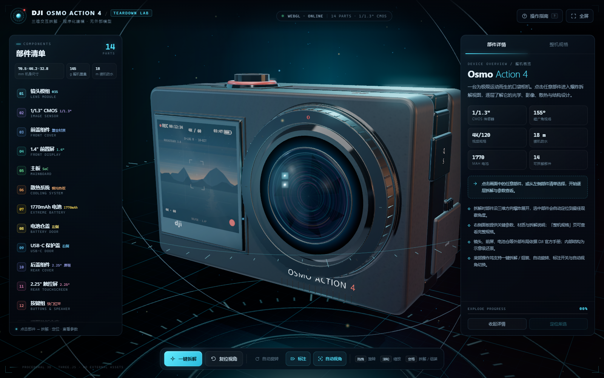
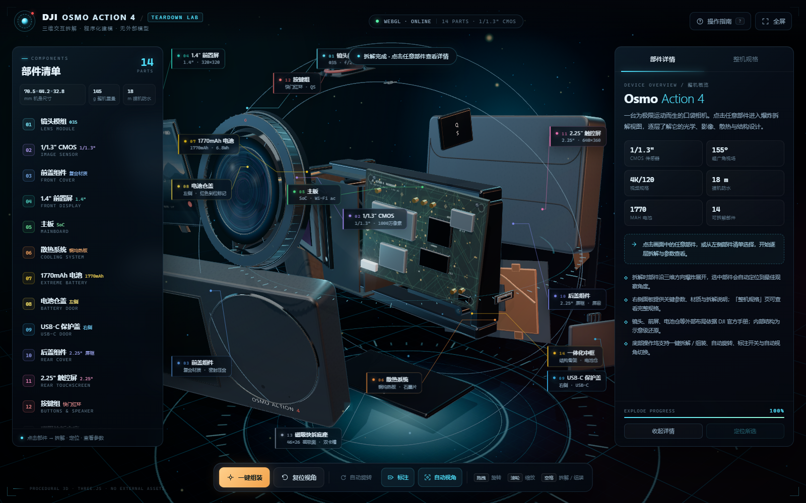
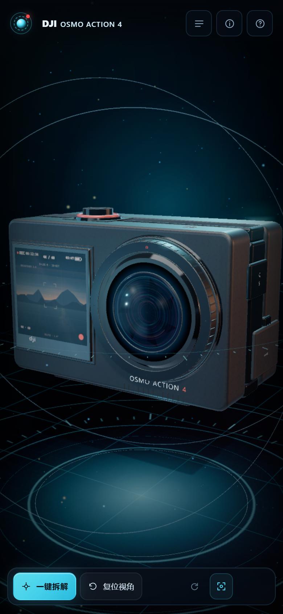

# DJI Osmo Action 4 · 3D 拆解实验室

一个完全由代码生成、可交互的 DJI Osmo Action 4 三维拆解可视化页面。使用 **Three.js + HTML + CSS + JavaScript**，不依赖任何外部 3D 模型、图片、字体或在线 CDN —— 所有几何体、贴图、屏幕 UI、PCB、镜头镀膜、电池铭牌均由代码在浏览器运行时生成。







## 快速开始

直接双击 `index.html` 即可（`file://` 下可正常运行，无需构建、无需本地服务器）。

如需通过 HTTP 访问：

```bash
# 任选一种，在项目目录下执行
python -m http.server 8080
# 或
npx serve .
```

然后打开 <http://localhost:8080>。推荐使用最新版 Chrome / Edge（需要 WebGL 2）。

## 功能

- **程序化 3D 机身**：按官方 70.5 × 44.2 × 32.8 mm 比例建模，还原正面右侧 Φ35 镜头、左侧 1.4" 方形前屏、顶部红环快门、右侧 QS 键与 USB-C 盖、左侧电池仓盖、底部磁吸快拆接口。
- **点击拆解**：点击任意部件，整机进入爆炸拆解动画；镜头自动飞向该部件、发光高亮，并展示参数详情。
- **自由视角**：鼠标拖拽 360° 旋转、滚轮缩放、右键平移；移动端单指旋转、双指缩放/平移。相机带阻尼。
- **部件标注**：拆解后显示每个部件的名称与关键参数，带科技感引线；选中部件时其他标注自动淡出，避免遮挡。
- **部件清单 / 参数说明**：左侧 14 个部件清单，右侧「部件详情 / 整机规格」面板，含材质、参数、拆解说明。
- **一键拆解 / 组装**、**复位视角**、**自动旋转**、**标注开关**、**自动视角开关**、**全屏**、**操作指南弹窗**。
- **响应式**：桌面双面板布局；≤960px 自动切换为抽屉式面板 + 移动端相机参数，手机竖屏可完整看到整机。
- 深色科技背景：HUD 环、刻度、粒子、程序化环境反射、Bloom 泛光、玻璃拟态 UI、扫描线与暗角。

## 交互与快捷键

| 操作 | 说明 |
| --- | --- |
| 拖拽 / 单指拖动 | 旋转视角 |
| 滚轮 / 双指捏合 | 缩放 |
| 右键拖拽 / 双指拖动 | 平移 |
| 点击部件 | 拆解 + 选中 + 查看详情 |
| 点击空白 | 取消选中（拆解状态保留） |
| `Space` | 拆解 / 组装 |
| `R` | 复位视角 |
| `L` | 标注开关 |
| `F` | 全屏 |
| `H` / `?` | 操作指南 |
| `Esc` | 关闭弹窗 / 取消选中 |

## 14 个可拆解部件

| # | 部件 | 关键参数 |
| --- | --- | --- |
| 01 | 镜头模组 | 155° FOV · f/2.8 · Φ35 mm 旋入式保护盖 |
| 02 | 1/1.3" CMOS | 3648 × 2736 · 约 1000 万像素 · 4K/120 |
| 03 | 前盖组件 | 70.5 × 44.2 mm · R3 圆角 · 哑光复合材质 |
| 04 | 1.4" 前置屏 | 320 × 320 · 323 ppi · 750 nit · 触控 |
| 05 | 主板 | 影像 SoC · Wi-Fi ac + BLE 5.0（内部示意） |
| 06 | 散热系统 | 铜均热板 + 石墨片（内部示意） |
| 07 | 1770mAh 电池 | 6.8 Wh · 3.85 V · 约 160 min 续航 |
| 08 | 电池仓盖 | 左侧 41 × 28 mm · 红色到位标记 |
| 09 | USB-C 保护盖 | 右侧下后部 · 30 W 快充 |
| 10 | 后盖组件 | 2.25" 屏框 · 金属屏蔽片 |
| 11 | 2.25" 触控屏 | 640 × 360 · 326 ppi · 750 nit |
| 12 | 按键组 | Φ13 快门红环 · QS 快切 · 4 孔扬声器 |
| 13 | 磁吸快拆底座 | 46 × 26 mm 贴合面 · 双侧卡槽 |
| 14 | 一体化中框 | 承力骨架 · 电池仓 · 双层密封 |

## 视觉与实现

- **几何**：`ExtrudeGeometry` 圆角外壳（5 段倒角 / 36 段曲线）、`RoundedBoxGeometry`、`Lathe/Cylinder/Torus` 镜筒、自定义 `BufferGeometry` 粒子与刻度环；主板、电池、镜头均为代码组件拼装。滚花环、镜筒、密封圈等细件使用更高分段，轮廓无多边形感。
- **贴图**：`CanvasTexture` 实时绘制前置/后置屏预览 UI、PCB 走线与丝印、电池铭牌、滚花/噪点/螺丝/镜头镀膜、屏幕反光，以及外壳「橘皮」与拉丝金属凹凸细节；全部贴图开启 mipmap，各向异性过滤取 GPU 上限（16×），斜视角下不糊、不闪。
- **抗锯齿**：整帧经由 `EffectComposer` 渲染到离屏纹理，画布级的 `antialias` 对它无效 —— 因此把 **4× MSAA 加在 composer 的 `HalfFloat` 渲染目标上**（低档 2×/关闭）。这是轮廓锯齿的根本修复。
- **渲染**：`MeshPhysicalMaterial`（清漆、虹彩镜片与 CMOS）、程序化渐变天空 + 柔光箱 PMREM 环境反射、**AgX 色调映射**（比 ACES 保留更多中调色彩分离）、半分辨率 `UnrealBloomPass` 辉光、PCF Soft 实时阴影（主光投影 + 接地阴影，拆解时淡出）、指数雾、程序化地面网格 shader、末段 8-bit 抖动（消除暗部渐变色带）。
- **动画**：自研时间轴（无 GSAP 等动画库），部件错峰爆炸、选中部件二次偏移、相机球面缓动、辉光脉冲。
- **UI**：原生 DOM + CSS（玻璃拟态、CSS 变量按部件主题色切换）；3D 标注使用 HTML + SVG 引线，屏幕空间约束与简单防重叠。
- **性能与自适应画质**：三档画质（MSAA 4×/2×/关闭、阴影 2048/1024/关闭、像素比 2/1.5/1、泛光开/开/关），启动按设备能力选档，运行中若持续低于约 45 fps 自动降一档且不回升（避免分辨率反复跳动）。rAF 单循环、纹理严格惰性生成；1600×1000（GTX 1650）下垂直同步稳定 60 fps，不限帧率实测约 113 fps。


## 目录结构

```text
dji-action4-3d/
├─ index.html                     # 页面骨架与 UI
├─ css/style.css                  # 视觉样式、动效、响应式
├─ js/
│  ├─ vendor/three-bundle.min.js  # Three.js r169 + 官方 addons（MIT，已本地化）
│  ├─ lib/textures.js             # 全部 Canvas 程序化贴图
│  ├─ lib/model.js                # Action 4 程序化模型与 14 个部件
│  └─ app.js                      # 渲染管线 / 场景 / 相机 / 交互 / 拆解动画 / UI
├─ docs/dji-action4-reference.md  # 官方资料调研与建模坐标参考
├─ qa/
│  ├─ review/                     # 独立验收脚本与报告（8/8 验收项通过，无 P0/P1）
│  └─ perf/                       # 渲染质量 / 性能审计（抗锯齿指标、帧率、前后对比）
├─ screenshots/                   # 效果截图
├─ LICENSE                        # 本项目 MIT License
├─ THIRD-PARTY-NOTICES.md         # 第三方许可
└─ README.md
```

## 验收

在 Chrome（WebGL 2 / NVIDIA 加速）下完成独立验收：**8/8 验收项 PASS，无 P0 / P1 缺陷**；自动化检查覆盖加载、14 部件一致性、全部按钮/快捷键、鼠标拖拽与滚轮、3D 点选、移动端抽屉与详情、1100 / 1600 双桌面视口、参数与官方资料一致性等。详见 [qa/review/review-report.md](qa/review/review-report.md)。

**画质优化后的复验（2026-10-27）**：渲染管线重做后在最终代码上重跑同一套脚本 —— **69/69 检查、8/8 验收项 PASS、无 console error / warning**。同时新增可复现的渲染质量 / 性能审计 `node qa/perf/render-audit.mjs --baseline --uncapped`（基线 = 优化前提交 `9edadf1`；纯 canvas、固定机位、3 帧中位）：

| 指标（1600×1000，DPR1） | 优化前 | 优化后 | 变化 |
| --- | --- | --- | --- |
| 边缘过渡像素占比 `edgeTransitionRatio`（越高 = 过渡越平滑） | 0.331% | 0.475% | +43.8% |
| 每边缘过渡像素 `edgeTransitionPerEdge` | 8.39% | 11.29% | +34.5% |
| 高频锯齿能量 `hfEnergy`（越低 = 越平滑） | 503.3 | 335.4 | −33.4% |
| 帧率（垂直同步，DPR1 / DPR2） | 60.00 / 60.00 | 60.00 / 60.00 | 持平 |
| 不限帧率 fps（渲染开销信号，越高越省） | 282.2 | 112.8 | −60.0% |

**结论**：抗锯齿显著改善，DPR1 下差异最明显（DPR2 本身有 2× 像素超采样兜底）；代价是每帧 GPU 开销约 2.4×，在 GTX 1650 上仍稳定 60 fps，更弱的集成显卡会由自适应画质自动降档。DPR2 停留 60 fps 时的默认启动档位为保守档（medium），用户可用 `DJI_APP.setQuality('high')` 取得 2× 像素比 + 4× MSAA 的最高档。完整数据、口径与前后截图见 [qa/perf/report.md](qa/perf/report.md)。


## 数据来源与免责声明

- 外观布局、屏幕规格、影像、电池、防水等依据 **DJI 官方规格页 / 用户手册 v1.2 / 官方产品图** 整理，详见 [docs/dji-action4-reference.md](docs/dji-action4-reference.md)。
- **内部结构（主板、散热、密封、拆解顺序）官方未公开**，页面中的内部件仅作「示意级」可视化表达，不代表真实拆解图；面板中已标注。
- DJI、Osmo Action 是 DJI 的商标。本项目为个人学习/展示用途的非官方可视化作品，与 DJI 无关联。

## 第三方许可

Three.js 及其官方 addons 以 MIT License 分发，版权归 Three.js Authors 所有；许可全文与本地化说明见 [THIRD-PARTY-NOTICES.md](THIRD-PARTY-NOTICES.md)。本项目页面代码同样以 MIT License 提供。
